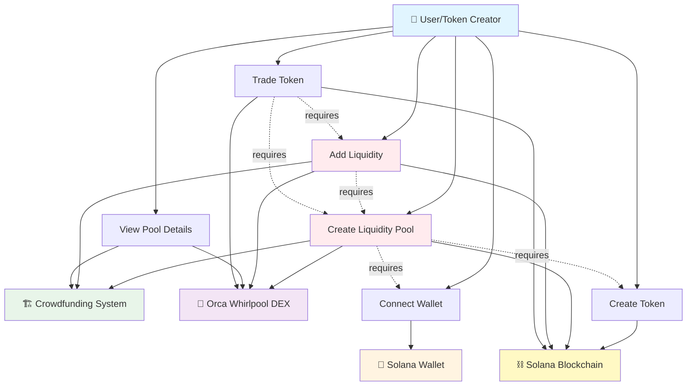
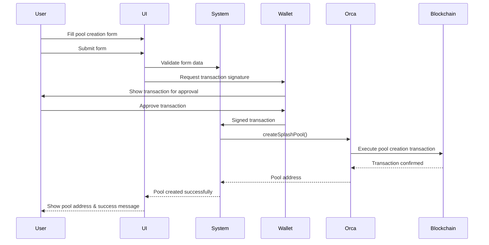
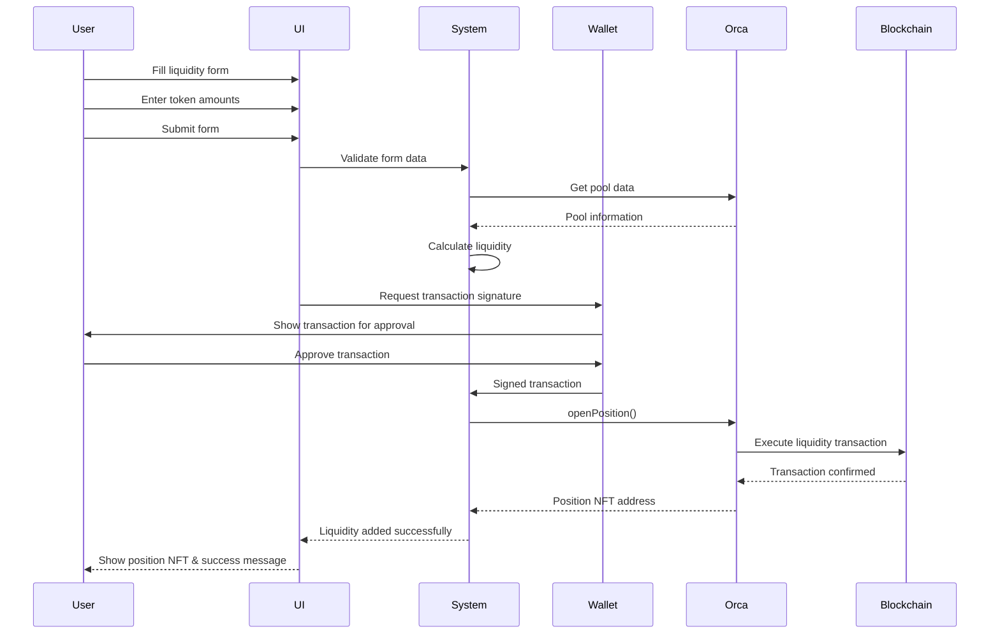
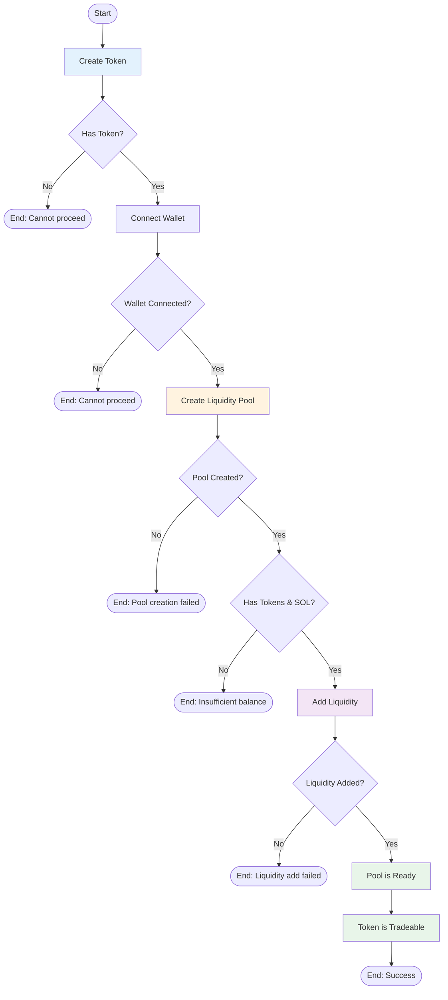
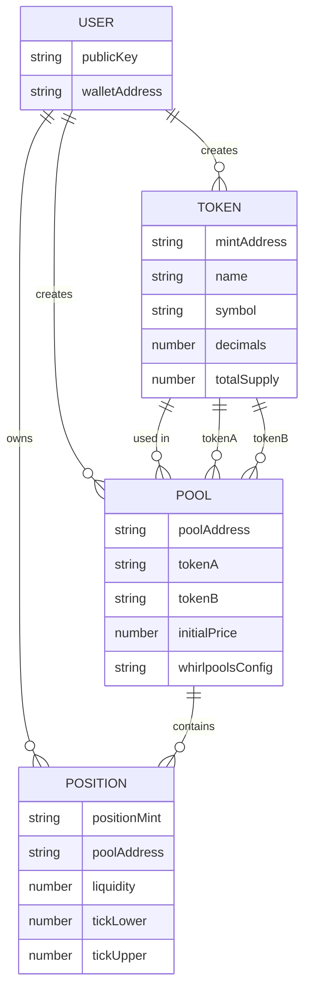
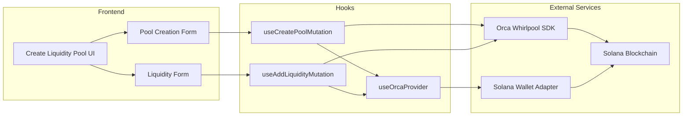
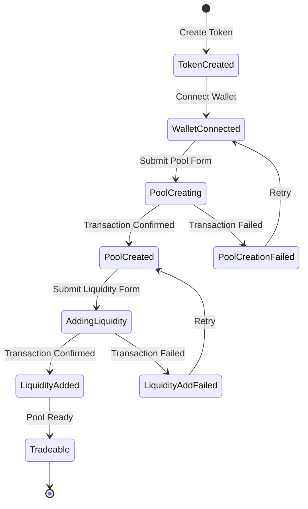

# Use Case Diagram: Create Liquidity Pool

## Use Case Diagram (Mermaid)

## Detailed Use Case Description

### UC1: Create Token
- **Actor:** User
- **Preconditions:** User has Solana wallet
- **Main Flow:**
  1. User fills token creation form (name, symbol, supply, decimals, metadata)
  2. User uploads token image
  3. System creates SPL token on Solana
  4. System mints tokens to user's wallet
  5. User receives token mint address
- **Postconditions:** Token exists on Solana, user owns tokens

### UC2: Connect Wallet
- **Actor:** User
- **Preconditions:** User has Solana wallet (Phantom, Solflare, etc.)
- **Main Flow:**
  1. User clicks "Connect Wallet"
  2. Wallet extension prompts for connection
  3. User approves connection
  4. System receives wallet public key
- **Postconditions:** Wallet is connected, user can sign transactions

### UC3: Create Liquidity Pool
- **Actor:** User
- **Preconditions:** 
  - User has created token (UC1)
  - Wallet is connected (UC2)
  - User has token mint address
- **Main Flow:**
  1. User enters token mint address
  2. User selects pair token (SOL/USDC)
  3. User sets initial price
  4. User submits pool creation form
  5. System creates Splash pool on Orca Whirlpool
  6. System executes transaction on Solana
  7. User receives pool address
- **Postconditions:** Liquidity pool exists on Orca, pool address is available

### UC4: Add Liquidity
- **Actor:** User
- **Preconditions:**
  - Pool is created (UC3)
  - User has tokens in wallet
  - User has pair token (SOL/USDC) in wallet
- **Main Flow:**
  1. User enters pool address (auto-filled after creation)
  2. User enters token amounts to add
  3. User sets token decimals
  4. User submits liquidity form
  5. System calculates liquidity amount
  6. System opens position on Orca Whirlpool
  7. System executes transaction on Solana
  8. User receives position NFT
- **Postconditions:** Liquidity added to pool, pool is tradeable

### UC5: View Pool Details
- **Actor:** User
- **Preconditions:** Pool exists (UC3)
- **Main Flow:**
  1. User views pool address
  2. User clicks "View on Explorer" or "View on Solscan"
  3. System opens blockchain explorer
- **Postconditions:** User can see pool details on explorer

### UC6: Trade Token
- **Actor:** User (any user, not just creator)
- **Preconditions:**
  - Pool exists (UC3)
  - Liquidity is added (UC4)
- **Main Flow:**
  1. User connects wallet to DEX (Orca, Raydium)
  2. User selects token pair
  3. User enters trade amount
  4. User executes swap
  5. DEX executes trade on Solana
- **Postconditions:** Tokens are swapped, user receives new tokens

## Sequence Diagram: Create Pool Flow

## Sequence Diagram: Add Liquidity Flow

## Activity Diagram: Complete Flow

## Entity Relationship Diagram

## Component Diagram

## State Diagram: Pool Lifecycle

## Key Points

1. **Dependencies:** Creating a pool requires a token and wallet connection. Adding liquidity requires a pool to exist.

2. **Actors:** The main actor is the User (token creator), but the system also interacts with external systems (Orca, Solana Blockchain).

3. **Use Cases:** The main use cases are creating a pool and adding liquidity, which are sequential and dependent on each other.

4. **Error Handling:** Each use case can fail, and the system should handle errors gracefully.

5. **Postconditions:** After successful completion, the pool is tradeable on DEXs.
